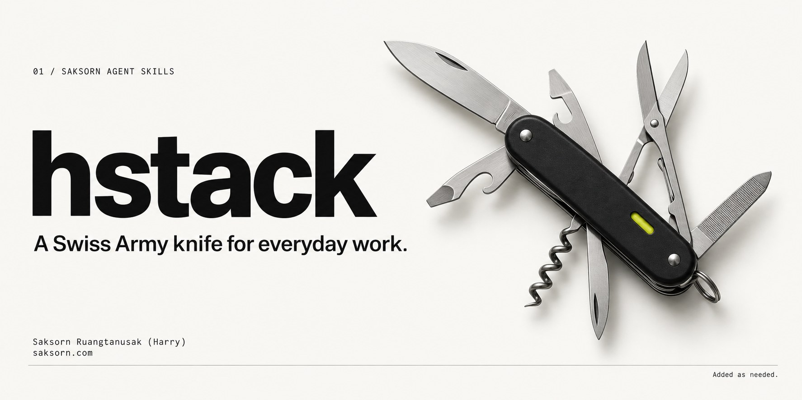

# hstack

A personal Swiss Army knife for everyday work by [Saksorn Ruangtanusak (Harry)](https://saksorn.com).

Built along the way. Added as needed.

[Source to Slides](source-to-slides/) — research and build image-led presentations.  
[Slide Polish](slide-polish/) — visually review, repair, and verify them.

[Thinking Like a Theorist](thinking-like-a-theorist/) — formalize problems, choose proof tools, and audit guarantees; inspired by Princeton COS 597D.

If you use it, please give this repo a star ⭐
